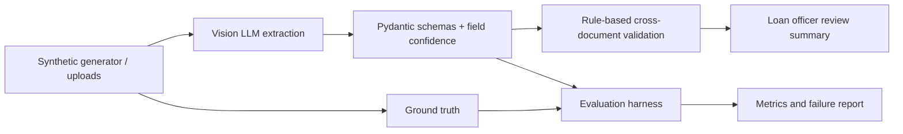

# DhuriDocs

**A GenAI-powered document intelligence prototype for Indian vehicle loan origination** by Kanishk Gupta.

DhuriDocs explores where AI may reduce repetitive document review and where it should defer to a loan officer. It generates 30 fully synthetic applications, extracts five vehicle-loan document types into typed schemas, applies transparent cross-document checks, and includes an evaluation harness. This is an AI use-case assessment prototype, not a lending decision system.

## Problem

Vehicle loan files combine invoices, income proofs, bank statements, insurance, and identity documents. Inconsistencies can require manual reconciliation. DhuriDocs tests extraction and consistency checks on a controllable synthetic corpus while making uncertainty and the evaluation gaps visible.

## Architecture



## Setup

Requires Python 3.11+.

```bash
python -m venv .venv
source .venv/bin/activate
pip install -r requirements.txt
cp .env.example .env
# Set OPENAI_API_KEY, or choose LLM_PROVIDER=anthropic and set ANTHROPIC_API_KEY
```

Do not commit `.env` or API keys.

## Run

```bash
python -m src.generator.generate
python -m src.evaluation.run
streamlit run app.py
pytest
```

The default evaluation command inventories the corpus and intentionally reports that model accuracy, inconsistency detection, latency, cost, and worst failures have not been measured. Run actual extraction with provider credentials before making performance claims. Noisy PNG variants sit alongside clean PDFs in each application directory.

## Evaluation status

The checked-in report is a baseline inventory, not evidence of model performance. Ground truth includes per-document values and injected inconsistencies. Update the harness with recorded predictions and execution metadata to calculate field-level clean/noisy accuracy, inconsistency precision/recall/false positives, per-application latency/cost, and the ten worst failures. Until then, metrics remain “not measured.”

## Business case

`config/business_case.yaml` contains explicit placeholders marked `ASSUMPTION: Kanishk to source/validate`. The app displays an upper-bound time/cost scenario and does not imply the prototype achieves that savings rate.

## Screenshots

- `[Screenshot placeholder: application review]`
- `[Screenshot placeholder: evaluation metrics]`

## Limitations

See [docs/LIMITATIONS.md](docs/LIMITATIONS.md). This prototype does not authenticate documents, detect tampering, underwrite credit, or support production handling of personal data.
